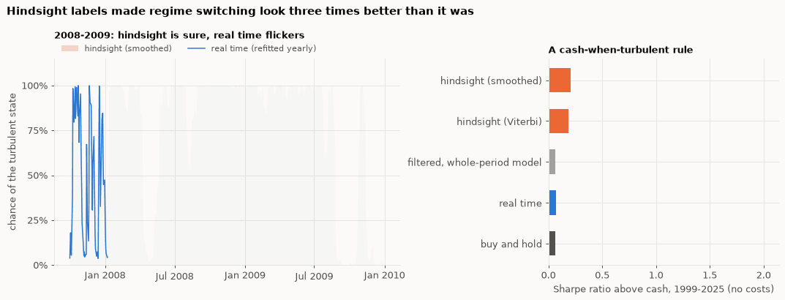
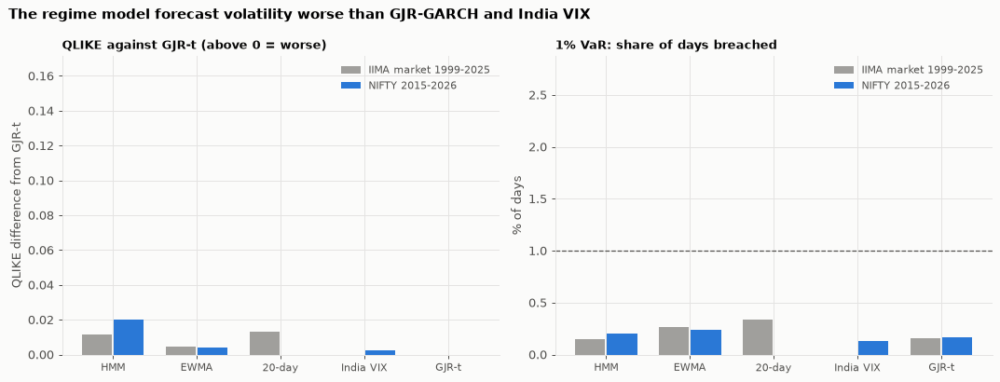
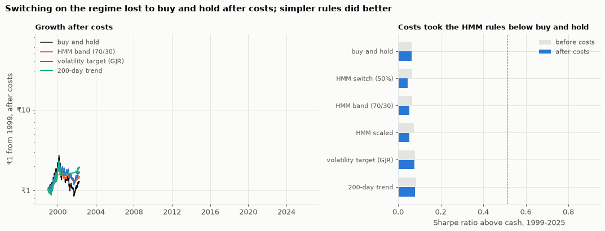
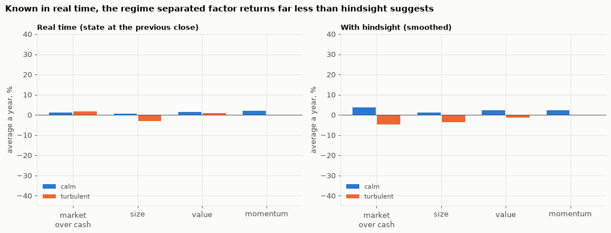
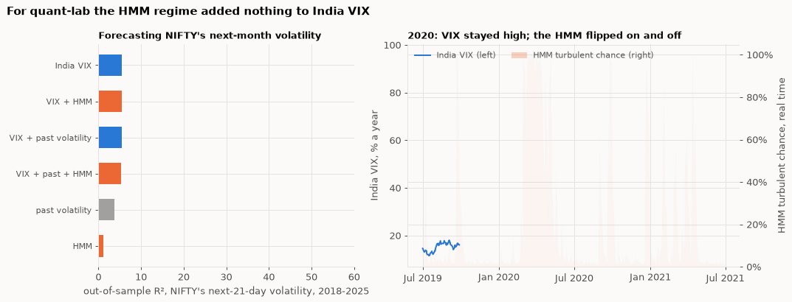

# Regime Detection HMM

[](https://github.com/Dhirajdas18/regime-detection-hmm/actions/workflows/ci.yml)
[](https://dhirajdas18.github.io/regime-detection-hmm/)

Hidden Markov models of calm and turbulent regimes in the Indian stock market, on IIM Ahmedabad's
daily market returns from 1993 to 2025 and, for comparisons with what an investor can trade, NIFTY,
India VIX and stocks from a local NSE archive (from 2013; only derived results committed): what the
states look like, the look-ahead trap in hindsight labels, how many states, volatility forecasts,
regime-switching allocation after costs, and factors by regime.

**Live regime lab: [dhirajdas18.github.io/regime-detection-hmm](https://dhirajdas18.github.io/regime-detection-hmm/)**,
pick any years and two or three states; the page fits the model in your browser and shows when
the market was calm or turbulent, as seen at the time and with hindsight.

## Features

- [x] Two and three states on daily market returns: their returns, volatility and persistence
- [x] The look-ahead trap: real-time (filtered) against hindsight (smoothed, Viterbi) states
- [x] How many states, and do they keep their meaning across refits, out of sample
- [x] Volatility and VaR forecasts from the regime against EWMA, GJR-GARCH and India VIX
- [x] Regime-switching between stocks and cash after costs, against volatility targeting and trend
- [x] Size, value and momentum by regime, out of sample
- [x] Verdict: does an HMM regime earn a place next to the reference model's current risk inputs

## Findings

### 1. Indian stocks switched between a calm and a turbulent state that lasted weeks

<a href="docs/img/states.png"><picture><source media="(prefers-reduced-motion: reduce)" srcset="docs/img/states.png"></picture></a>

IIMA's daily market return (the market premium plus the risk-free rate, survivorship-bias
adjusted) as a log return, 8,002 trading days from October 1993 to December 2025. A Gaussian hidden
Markov model gives each day one of two or three hidden states, each with its own average and
volatility and a fixed chance of switching each day; it is fitted by expectation-maximisation from
four starts, and states are sorted from calmest to most turbulent. Everything here is fitted on
the whole period and the shaded episodes use smoothed probabilities, which see the future; finding
2 deals with that. For comparison, a simple rule marks days whose 20-day volatility is above the
level that gives the same share of turbulent days. Annual figures use 250 trading days.

- **Two states: calm and turbulent.** The calm state had 12.6% volatility a year and lasted 44 days
  on average, 70% of days; the turbulent state 34.1% volatility, 19 days, 30% of days. Their average
  returns were +30% and −30% a year, which describes the states with hindsight, not a forecast.
- **Three states split off a crash state.** Volatility of 11.0%, 21.5% and 48.6% a year, lasting 38,
  21 and 14 days, on 50%, 41% and 9% of days; the crash state averaged −89% a year.
- **The long turbulent spells were the big crashes.** The longest were May 2008 to August 2009 (309
  trading days), December 1999 to June 2000 (128) and February to August 1998 (112).
- **A simple volatility rule saw much the same.** With a threshold of 21.0% a year it agreed with the
  two-state model on 84% of days and gave 98 turbulent runs (median 16 days) against the model's 100
  (median 12).

### 2. Hindsight labels made regime switching look three times better than it was

<a href="docs/img/lookahead.png"><picture><source media="(prefers-reduced-motion: reduce)" srcset="docs/img/lookahead.png"></picture></a>

The two-state model of finding 1, scored from January 1999 to December 2025 (6,720 days) in three
ways. Hindsight: smoothed probabilities and the Viterbi path, from a model fitted on 1993–2025, so
both the labels and the model see the future. Filtered: probabilities from only the days up to each
date, but from that same whole-period model. Real time: the model refitted at each year-end (27
times) on the days up to it, then filtered through the next year, so nothing after a day is used
on that day. A state counts as turbulent above 50%. A toy rule holds the market on days after a calm
close and cash (IIMA's risk-free rate) after a turbulent one, with no trading costs (finding 5 adds
them); Sharpe ratios are measured above the risk-free rate.

- **Hindsight looked excellent.** The toy rule's Sharpe ratio was 1.71 with smoothed states and
  1.51 with the Viterbi path, compounding 27.6% and 25.4% a year.
- **Real time was ordinary.** With real-time states it was 0.56 (14.4% a year, volatility 14.8%),
  with filtered states from the whole-period model 0.55, and buy and hold 0.51 (16.1% a year,
  volatility 21.4%): lower risk for lower return.
- **Real time was a few days late.** It caught 29 of the 30 hindsight turbulent spells of 20 days or
  more, a median of 3 trading days after they began (mean 4.4); 23 of its 219 turbulent runs never
  touched a hindsight turbulent day.
- **Real time and hindsight agreed on most days, just not the ones that matter.** Real-time states
  matched smoothed ones on 88.5% of days and flagged 19% of days as turbulent against 28%; in
  2008–2009 the real-time chance flickered between near 0 and near 100% while hindsight was sure.
- **The model itself barely changed.** Refitted every year, its turbulent state's volatility ranged
  from 32% to 41% a year.

### 3. Three states beat two out of sample in most years; a fourth added little

<a href="docs/img/count.png"><picture><source media="(prefers-reduced-motion: reduce)" srcset="docs/img/count.png"></picture></a>

In sample, the information criteria BIC and AIC for 1 to 5 states fitted on 1993–2025. Out of
sample, finding 2's real-time scheme for 1 to 4 states: the model refitted at each year-end on
past days only, then each day from January 1999 to December 2025 (6,720 days) scored by the
log of the density the model gave that day's return before seeing it (higher is better; one state
is a constant-volatility normal). Each added state's daily gain gets a Newey-West t (20 lags) and
the share of the 27 years in which it helped. The refits also show how far each state's volatility
moved from year to year.

- **More states always fitted better in sample.** BIC fell from 27,644 (one state) to 24,928, 24,546,
  24,431 and 24,352 (five), so it never chose a number.
- **Two states were a big step out of sample, three a real one, four marginal.** Two beat one by
  0.194 a day (t 13.25) in all 27 years; three beat two by 0.025 (t 7.85) in 93% of years; four beat
  three by 0.008 (t 3.14) in only 52% of years.
- **The fourth state was often not a regime.** In 11 of 27 refits the four-state model's calmest
  state had a volatility of 0.3–3.0% a year and a chance of staying of 0.08–0.59 a day: it was
  absorbing the many very small daily moves, a quirk of the return distribution, not a market mood.
- **Two states were the most stable.** Across refits the calm state's volatility ran 13–17% and the
  turbulent 32–41%; with three states the middle state ran 12–27%, close to the calm one before
  2004.

### 4. The regime model forecast volatility worse than GJR-GARCH and India VIX

<a href="docs/img/forecast.png"><picture><source media="(prefers-reduced-motion: reduce)" srcset="docs/img/forecast.png"></picture></a>

Each day's variance and 1% value at risk forecast from data before it: the two-state HMM refitted
at each year-end (its forecast is a mixture of the states' normals, weighted by tomorrow's state
chances from today's filtered ones), EWMA (λ 0.94), the 20-day standard deviation, and
GJR-GARCH(1,1) with Student-t shocks refitted at each year-end (the volatility model the reference model uses
now). Two samples: IIMA's market, January 1999 to December 2025 (6,720 days), and NIFTY's daily
return from the NSE archive, January 2015 to November 2026 (2,927 days with India VIX), where the
HMM and GJR are first fitted on 2013–2014 and India VIX at the previous close gives a variance
forecast (VIX² / 250). Forecasts are scored by QLIKE (lower is better; Newey-West t with 20 lags
on the daily difference from GJR) and VaR by the share of days breached, against 1%, with the
Kupiec test (above 3.84 rejects at 5%). EWMA, 20-day and VIX VaR assume normal returns.

- **GJR-GARCH forecast variance best.** On IIMA's market its QLIKE was 1.206 against 1.244 for
  EWMA (t 2.88), 1.300 for the HMM (t 7.46) and 1.312 for the 20-day standard deviation (t 5.98).
- **On NIFTY, India VIX was as good as GJR; the HMM wasn't.** QLIKE 0.725 for GJR, 0.744 for VIX (t
  0.86 against GJR), 0.759 for EWMA (t 2.04) and 0.888 for the HMM (t 1.79).
- **The HMM's VaR was well calibrated on the long history, not on NIFTY.** Its two-state mixture's
  fat tails gave 1.19% breaches on IIMA's market (Kupiec 2.3, not rejected; GJR 1.32%, rejected at
  6.5), but 1.64% on NIFTY (rejected, 10.1), with its first fit on only two years.
- **India VIX gave the best-calibrated VaR on NIFTY.** 1.06% breaches (Kupiec 0.1); GJR 1.33% (3.0,
  not rejected); EWMA 1.95% and the 20-day rule 2.74% (on IIMA) breached far too often.

### 5. Switching on the regime lost to buy and hold after costs; simpler rules did better

<a href="docs/img/allocate.png"><picture><source media="(prefers-reduced-motion: reduce)" srcset="docs/img/allocate.png"></picture></a>

Stocks-or-cash rules on IIMA's market, January 1999 to December 2025, each deciding at a day's
close from data up to it and holding that weight the next day; cash earns IIMA's risk-free rate.
HMM rules use finding 2's real-time turbulent chance: switch to cash above 50%; a band (cash above
70%, back below 30%, set in advance to cut flicker); and scaled (weight equal to the calm chance,
traded only when it moves more than 0.1). Volatility targeting holds the 1993–1998 volatility
(21.8% a year) divided by GJR-GARCH's forecast (finding 4), capped at 1 and traded on moves over
0.1. The 200-day trend rule holds the market when it is above its 200-day average, a standard
setting not tuned here. Every trade pays equity delivery costs as in momentum-after-costs (STT 0.1%
each side, stamp duty, exchange and SEBI charges with GST, 5 bp slippage); an index ETF pays less
STT, so these are on the high side. No tax.

- **Every HMM rule lost to buy and hold after costs.** Sharpe ratios above cash were 0.38 (switch),
  0.43 (band) and 0.44 (scaled) against 0.51; before costs 0.56, 0.53 and 0.60.
- **The HMM's flicker cost the most.** The plain switch traded its whole position 16.3 times a year,
  paying 2.62% a year; the band halved that to 7.9 times and 1.28%; the scaled rule 2.10%.
- **Volatility targeting and the trend rule did better than buy and hold.** Sharpe 0.62 and 0.64
  after costs, compounding 16.5% a year each against 16.1%, with volatility of 16.7% and 15.9%
  against 21.4%; their gains over buy and hold were not tested for significance.
- **Lower risk was the HMM's one gain.** Worst falls were −40%, −53% and −31% against −69% for buy
  and hold, but the trend rule's was −33% for a higher return.
- **The HMM rules weakened in the second half.** Their Sharpe ratios fell from 0.46–0.53 in
  1999–2012 to 0.27–0.40 in 2013–2025; volatility targeting held at 0.64 and 0.62.

### 6. Known in real time, the regime separated factor returns far less than hindsight suggests

<a href="docs/img/factors.png"><picture><source media="(prefers-reduced-motion: reduce)" srcset="docs/img/factors.png"></picture></a>

IIMA's daily market, size (small minus big), value (cheap minus expensive) and momentum (winners
minus losers) returns, January 1999 to December 2025 (6,719 days). Each day is labelled by
finding 2's real-time turbulent chance at the previous close, so the label was known before the
day's return (turbulent on 19% of days), and, for contrast, by the hindsight state that day.
Averages are 250 times the daily mean; the difference between calm and turbulent days gets a
Newey-West t (20 lags). A paper rule holds each long-short factor only after calm closes, with no
costs; IIMA's factors are not directly investable.

- **With hindsight the regime split everything; in real time it split almost nothing.** The market's
  return over cash was +29.8% a year on hindsight-calm days and −38.9% on turbulent ones (t −4.51),
  but +10.2% and +13.8% when the state was known only from the previous close (t 0.20).
- **Small companies did badly after turbulent closes, but only before 2013.** Size averaged −23.8% a
  year on real-time turbulent days against +5.0% on calm ones (t −3.18): −30.7% against +11.3% in
  1999–2012, then +3.1% against −0.3% in 2013–2025.
- **Momentum earned nearly all its return after calm closes.** +16.9% a year against +1.2% (20.4%
  against 0.9% in 1999–2012, 14.0% against 2.4% in 2013–2025), though the difference was not
  significant (t −0.89); holding it only after calm closes lifted its paper Sharpe ratio from 0.80
  to 1.06, mostly by skipping its most volatile days (26.7% a year against 14.3%).
- **Value didn't care.** +11.3% against +7.2% a year (t −0.36).
- **No daily momentum crash in turbulent rebounds.** On the 734 real-time turbulent days when the
  market rose, momentum averaged −0.001% a day; ff/06's crashes were a monthly, post-bear-market
  pattern.

### 7. For the reference model the HMM regime added nothing to India VIX

<a href="docs/img/verdict.png"><picture><source media="(prefers-reduced-motion: reduce)" srcset="docs/img/verdict.png"></picture></a>

the reference model already reads the risk regime from India VIX (with stress breadth, not tested here). The
question is whether the HMM adds to it: NIFTY's realised volatility over the next 21 trading days
(in logs) is forecast at each close from India VIX, NIFTY's past 21-day volatility and finding 2's
real-time turbulent chance (fitted on IIMA's market), January 2015 to December 2025 (2,707 days).
From January 2018 each forecast is a least-squares fit on the days whose 21-day outcome was already
complete, scored against those days' average (out-of-sample R²; 1,975 forecasts, overlapping, so
about 95 independent months). The HMM's turbulent flag is also compared with VIX above its own
expanding 80th percentile.

- **India VIX alone forecast best.** Out-of-sample R² 45.3%; past volatility 31.1%; the HMM 9.7%.
- **Adding the HMM made VIX slightly worse.** 45.0% with VIX and the HMM, 43.9% with VIX, past
  volatility and the HMM; the extra squared error was not significant (t 0.35).
- **The two flags mostly agreed, on different scales.** The HMM called 9% of days turbulent, VIX
  was in its top fifth on 21%; they made the same call on 82% of days, and the HMM's chance
  correlated 0.48 with log VIX. In 2020 VIX tracked the stress continuously while the HMM's chance
  flipped between near 0 and near 100%.
- **The verdict.**

  | Question | Answer (finding) |
  |---|---|
  | Do regimes exist? | Yes: calm and turbulent spells lasting weeks (1) |
  | Can you see them in real time? | Only ~3 days late, with flicker; hindsight labels mislead (2) |
  | How many states? | Two; a fourth was a distribution quirk (3) |
  | Better risk forecasts? | No: GJR-GARCH and India VIX did better (4) |
  | Better allocation? | No: lost to buy and hold after costs; volatility targeting and trend did better (5) |
  | Factor timing? | Only a candidate: momentum earned little after turbulent closes (6) |
  | Next to India VIX? | Adds nothing (7) |

## Quick start

```bash
uv sync
uv run python scripts/fetch_data.py   # IIMA factor library -> data/iima/
uv run rh report states               # topics: states, lookahead, count,
                                      # forecast, allocate, factors,
                                      # verdict
uv run python scripts/build_site.py   # regime lab -> site/index.html
uv run pytest
```

The data files are downloaded, not committed. The NIFTY comparison reads NIFTY and India VIX from a
local NSE archive (`RH_LAKE_DIR`, default `/path/to/lake`).

## Design

- `src/rh/data.py`: finds the IIMA library's latest release and downloads its survivorship-bias
  adjusted daily and monthly files.
- `src/rh/hmm.py`: the Gaussian hidden Markov model: scaled forward and backward passes, filtered
  and smoothed probabilities, Viterbi, Baum-Welch from several starts with states sorted by
  volatility, BIC, and real-time probabilities refitted each year-end; checked against hmmlearn in
  the tests.
- `src/rh/forecast.py`: one-day-ahead variance and 1% VaR from the HMM, EWMA, the 20-day standard
  deviation and GJR-GARCH-t (arch), each refitted on past data only; QLIKE and the Kupiec test.
- `src/rh/allocate.py`: stocks-or-cash rules held a day after each decision, with delivery costs,
  a hysteresis band, a sticky weight, and summary statistics.
- `src/rh/lake.py`: NIFTY and India VIX from the local NSE archive.
- `src/rh/rh.js`: the lab's browser copy of the fit and the filter, tested against Python through
  Node.
- `src/rh/site.py`: the regime lab, one static Plotly page carrying the daily market returns.
- `src/rh/reports.py`: README findings, reproducible with `rh report <topic>`.
- Conventions: daily log returns in percent; annual means are 250 times the daily mean, annual
  volatility √250 times the daily.
- Data: IIM Ahmedabad's Indian Fama-French-momentum data library (Agarwalla, Jacob and Varma, 2013,
  Four factor model in Indian equities market, IIMA Working Paper 2013-09-05), daily market return.
- Charts: one validated palette; README charts are animated GIFs with a static fallback for
  reduced-motion users.

Research only, not investment advice. MIT licence.
