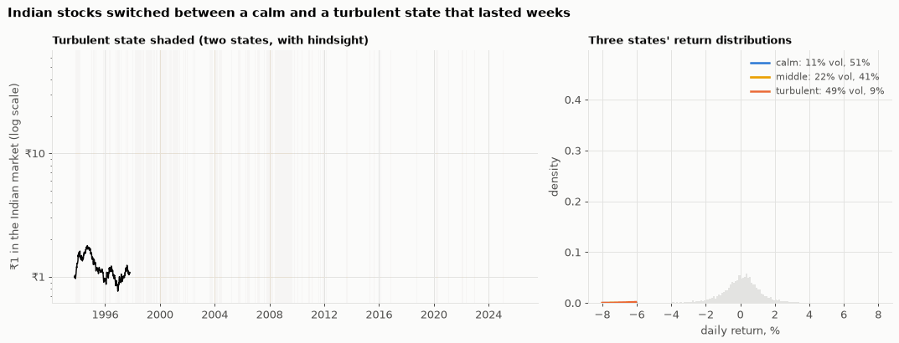

# Regime Detection HMM

[](https://github.com/Dhirajdas18/regime-detection-hmm/actions/workflows/ci.yml)
[](https://dhirajdas18.github.io/regime-detection-hmm/)

Hidden Markov models of calm and turbulent regimes in the Indian stock market, on IIM Ahmedabad's
daily market returns from 1993 to 2025 and, for comparisons with what an investor can trade, NIFTY,
India VIX and stocks from a local NSE archive (from 2013; only derived results committed): what the
states look like, the look-ahead trap in hindsight labels, how many states, volatility forecasts,
regime-switching allocation after costs, and factors by regime.

**Live regime lab: [dhirajdas18.github.io/regime-detection-hmm](https://dhirajdas18.github.io/regime-detection-hmm/)**,
pick any years and two or three states; the page fits the model in your browser and shows when
the market was calm or turbulent, as seen at the time and with hindsight.

## Features

- [x] Two and three states on daily market returns: their returns, volatility and persistence
- [ ] The look-ahead trap: real-time (filtered) against hindsight (smoothed, Viterbi) states
- [ ] How many states, and do they keep their meaning across refits, out of sample
- [ ] Volatility and VaR forecasts from the regime against EWMA, GJR-GARCH and India VIX
- [ ] Regime-switching between stocks and cash after costs, against volatility targeting and trend
- [ ] Size, value and momentum by regime, out of sample
- [ ] Verdict: does an HMM regime earn a place next to the reference model's current risk inputs

## Findings

### 1. Indian stocks switched between a calm and a turbulent state that lasted weeks

<a href="docs/img/states.png"><picture><source media="(prefers-reduced-motion: reduce)" srcset="docs/img/states.png"></picture></a>

IIMA's daily market return (the market premium plus the risk-free rate, survivorship-bias
adjusted) as a log return, 8,002 trading days from October 1993 to December 2025. A Gaussian hidden
Markov model gives each day one of two or three hidden states, each with its own average and
volatility and a fixed chance of switching each day; it is fitted by expectation-maximisation from
four starts, and states are sorted from calmest to most turbulent. Everything here is fitted on
the whole period and the shaded episodes use smoothed probabilities, which see the future; finding
2 deals with that. For comparison, a simple rule marks days whose 20-day volatility is above the
level that gives the same share of turbulent days. Annual figures use 250 trading days.

- **Two states: calm and turbulent.** The calm state had 12.6% volatility a year and lasted 44 days
  on average, 70% of days; the turbulent state 34.1% volatility, 19 days, 30% of days. Their average
  returns were +30% and −30% a year, which describes the states with hindsight, not a forecast.
- **Three states split off a crash state.** Volatility of 11.0%, 21.5% and 48.6% a year, lasting 38,
  21 and 14 days, on 50%, 41% and 9% of days; the crash state averaged −89% a year.
- **The long turbulent spells were the big crashes.** The longest were May 2008 to August 2009 (309
  trading days), December 1999 to June 2000 (128) and February to August 1998 (112).
- **A simple volatility rule saw much the same.** With a threshold of 21.0% a year it agreed with the
  two-state model on 84% of days and gave 98 turbulent runs (median 16 days) against the model's 100
  (median 12).

## Quick start

```bash
uv sync
uv run python scripts/fetch_data.py   # IIMA factor library -> data/iima/
uv run rh report states               # topics: states
uv run python scripts/build_site.py   # regime lab -> site/index.html
uv run pytest
```

The data files are downloaded, not committed.

## Design

- `src/rh/data.py`: finds the IIMA library's latest release and downloads its survivorship-bias
  adjusted daily and monthly files.
- `src/rh/hmm.py`: the Gaussian hidden Markov model: scaled forward and backward passes, filtered
  and smoothed probabilities, Viterbi, Baum-Welch from several starts with states sorted by
  volatility, BIC; checked against hmmlearn in the tests.
- `src/rh/rh.js`: the lab's browser copy of the fit and the filter, tested against Python through
  Node.
- `src/rh/site.py`: the regime lab, one static Plotly page carrying the daily market returns.
- `src/rh/reports.py`: README findings, reproducible with `rh report <topic>`.
- Conventions: daily log returns in percent; annual means are 250 times the daily mean, annual
  volatility √250 times the daily.
- Data: IIM Ahmedabad's Indian Fama-French-momentum data library (Agarwalla, Jacob and Varma, 2013,
  Four factor model in Indian equities market, IIMA Working Paper 2013-09-05), daily market return.
- Charts: one validated palette; README charts are animated GIFs with a static fallback for
  reduced-motion users.

Research only, not investment advice. MIT licence.
